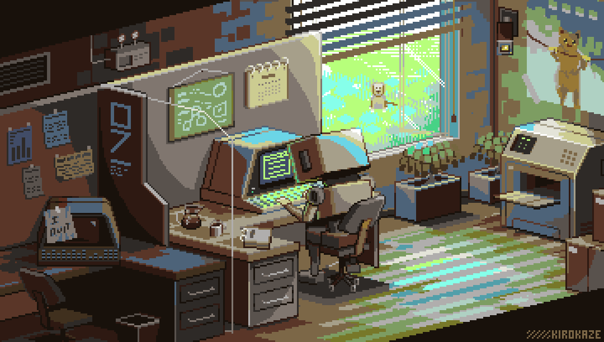

# Hello World! 👨🏻‍💻 I'm Mohammad_Fathollahi

<!-- Add a banner.gif or pixel-art header image to your MmiF/MmiF repository -->

---

### 📌 About Me

> 💡 _Front-end developer focused on TypeScript, React, browser internals, and accessible UI architecture—building clean, intentional interfaces and sharpening security fundamentals on Linux._

---

### 📊 GitHub Stats & Trophies

  
  

  

  

---

### 🛠️ Languages & Tools

#### Programming Languages

  

---

#### Frontend

  

---

#### Backend

  

---

#### Tools, OS & Workflow

  

---

### 🔗 Connect with Me

  
  
  

---

  

